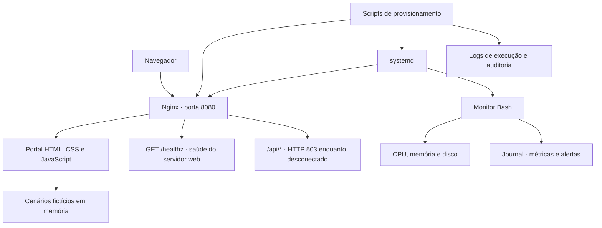
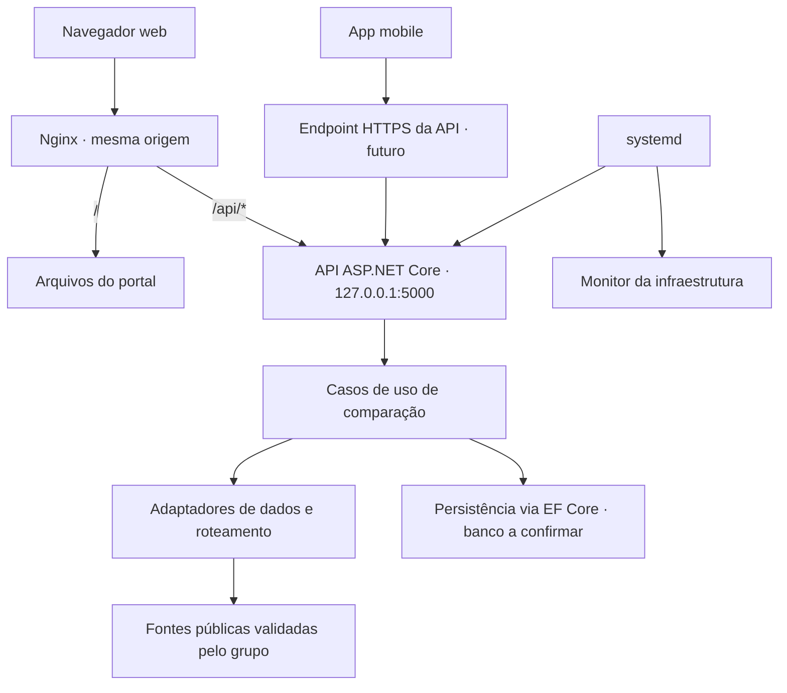

# VoltaSegura — Arquitetura da entrega de Operating Systems

## Objetivo e status

Proposta de arquitetura para executar a aplicação web CitizenTech em VM Linux, com provisionamento Bash, monitoramento, auditoria e recuperação de falhas.

- [DECISÃO desta implementação] Portal web sem build, em HTML/CSS/JavaScript, com identidade navy `#0D1B2A`, dourado `#FFC53D` e ciano `#4ECDC4`, derivados do mockup enviado pelo grupo.
- [IMPLEMENTADO NO CÓDIGO] Portal, scripts Bash, serviço de monitoramento, configuração Nginx e teste de falha.
- [EM ABERTO] Execução completa dos scripts na VM Ubuntu do grupo; não confundir arquivo implementado com infraestrutura já validada.
- [EM ABERTO] Backend C#/.NET em desenvolvimento pelo grupo. Nenhuma integração real com a API foi verificada.
- [PROPOSTA] Integração futura por proxy Nginx para API ASP.NET Core local. A versão do runtime será a do `TargetFramework` do projeto real, ainda não fornecido.

## Arquitetura implementada para demonstração



O portal entrega uma jornada interativa: definir origem/destino fictícios, horário e sentido, comparar duas alternativas, selecionar uma, visualizar etapas e consultar limitações. Dados ficam em memória durante a página aberta. Não há conta, geolocalização, persistência de busca, rastreamento, pagamento ou integração oficial implementados.

Os tempos de 32 e 38 minutos, caminhadas de 1.200 e 600 metros e etapas são exemplos sintéticos. A interface exibe exposição estimada como “dados insuficientes” e confiança como “não avaliada”. O horário não recalcula o cenário fixo de demonstração. A imagem do trajeto é um esquema sem coordenadas e não muda com a seleção.

O endpoint `/healthz` comprova o atendimento do servidor web. Não comprova disponibilidade de backend, banco ou fontes públicas.

## Arquitetura de integração proposta



O diagrama futuro descreve responsabilidades, não serviços já existentes. Manter um backend modular é suficiente para o escopo acadêmico; não há requisito que justifique microsserviços, Kubernetes ou fila neste momento. O monitor mede a VM; não é uma integração com a entrega de ML ou com o dashboard de Cybersecurity.

### Responsabilidades do backend — proposta para alinhar com a equipe

| Camada | Responsabilidade proposta |
|---|---|
| Web API | Receber DTOs, validar requisições, responder HTTP e documentar contrato |
| Aplicação | Orquestrar busca e comparação de alternativas |
| Domínio | Regras de comparação, suficiência e explicação dos indicadores |
| Infraestrutura | EF Core, adaptadores de bases, roteamento e configurações |

Endpoints, modelo de dados, versão .NET, autenticação, migrations e banco precisam ser confirmados com quem desenvolve a API. Não criar uma segunda implementação concorrente apenas para OS.

## Contrato inicial proposto, ainda não aprovado pelo backend

`POST /api/routes/compare`

```json
{
  "originId": "campus-exemplo",
  "destinationId": "terminal-exemplo",
  "departureAt": "2026-11-19T02:00:00Z",
  "direction": "volta"
}
```

```json
{
  "routes": [
    {
      "id": "exemplo-a",
      "label": "Menor tempo",
      "durationMinutes": 32,
      "walkingMeters": 1200,
      "transfers": 1,
      "exposureStatus": "insufficient_data",
      "dataConfidence": "not_evaluated",
      "steps": ["Etapa de exemplo"]
    }
  ]
}
```

Todos os valores acima são exemplos. O primeiro adaptador aceita somente `insufficient_data` e `not_evaluated`; rejeita outros estados para não apresentar uma classificação que ainda não sabe explicar. Ao implementar estados conclusivos, acrescentar proveniência, período, cobertura, metodologia e mensagens correspondentes antes de ampliar a validação do frontend.

- `200` com `routes: []`: nenhuma alternativa disponível.
- `400`: entrada inválida, conforme contrato a definir.
- `503`: backend ou dependência indisponível.
- Timeout no navegador: apresentar erro; nunca substituir silenciosamente por mock.
- `GET /api/health` é uma sugestão para a API futura, não uma rota existente.

Na integração real, trocar o catálogo fictício de locais por IDs/entradas aceitos pela API. Não basta mudar apenas o modo em `config.js`.

## Infraestrutura e operação

| Componente | Local ou configuração |
|---|---|
| Ambiente-alvo | VM Ubuntu Server nova com systemd, Netplan e uma interface Ethernet |
| Rede | DHCP IPv4; DNS explícito 1.1.1.1 e 8.8.8.8 no laboratório |
| Hostname | `voltasegura-os` |
| Portal | `/var/www/voltasegura` |
| Porta de demonstração | TCP 8080 |
| Monitor | `/usr/local/bin/voltasegura-monitor.sh` |
| Configuração do monitor | `/etc/voltasegura/monitor.env` |
| Serviço do monitor | `voltasegura-monitor.service` |
| Logs dos scripts | `/var/log/voltasegura/` |
| Métricas e alertas | `journalctl -u voltasegura-monitor` |
| Saúde web | `GET /healthz` |
| API futura | `/opt/voltasegura/api`, loopback 5000, serviço próprio |

O provisionador de rede foi escrito para uma VM nova cujo ID Ethernet no Netplan é igual ao nome da interface. Configurações com `match`, `set-name`, IPs estáticos existentes, múltiplas interfaces ou VPN exigem adaptação. Há backup antes da alteração; execute pelo console da VM. O uso de DNS público deve ser adaptado caso a rede do laboratório bloqueie esses resolvedores.

CPU é medida por diferenças de contadores de `/proc/stat` durante o intervalo. A memória usa `MemAvailable` e `MemTotal`. O disco usa a ocupação do filesystem `/`. O monitor roda com usuário dinâmico sem privilégios de root. A política de reinício tenta recuperar falhas de processo; erros permanentes de configuração podem atingir o limite de reinícios e exigem correção operacional. A política não é uma garantia de disponibilidade.

## Logs, privacidade e segurança

- O portal não grava consultas em armazenamento local ou servidor no modo demo.
- O formato de acesso específico do portal omite IP, query string e corpo. Logs de erro do Nginx e registros de sistema podem conter metadados; revisar antes de compartilhar. O servidor padrão do Nginx, se mantido, possui configuração própria de logs.
- Não ativar logs de corpo de requisição, origem/destino ou tokens ao integrar a API.
- Secrets da API devem permanecer fora do Git, com permissões restritas e acesso apenas pelo serviço.
- O ambiente entregue é um laboratório HTTP. Para acesso público real, provisionar HTTPS, domínio, controles de acesso, política de retenção e revisão de segurança.
- Não há promessa de segurança física ou validação da metodologia de exposição nesta implementação.

## Critérios de aceite

1. VM nova executa o script principal sem preparação manual além dos pré-requisitos documentados.
2. IP, DNS e hostname são verificáveis após o provisionamento.
3. Portal atende em 8080 e jornada demo funciona.
4. CPU, memória e disco são registrados; limites reduzidos produzem alertas dos três recursos.
5. Monitor recupera-se após SIGKILL com novo PID e aumento de `NRestarts`.
6. Após reboot, Nginx e monitor ficam ativos.
7. Logs comprovam execução e falhas, sem segredos.
8. API futura só é declarada integrada após testes reais de sucesso, erro, banco e dependências.

## Aderência ao enunciado e dependências

O enunciado pede hospedar uma aplicação WEB desenvolvida em outra disciplina. O portal permite desenvolver e testar a infraestrutura enquanto a API não está pronta. Sua existência isolada não comprova essa integração. Antes da entrega final, conectar e demonstrar a API de C#/SOA ou alinhar explicitamente com o professor a aceitação da versão demonstrativa.

Não atribuir uma nota garantida. Arquitetura é documentação complementar: não substitui scripts, execução, evidências ou vídeo.

## Fontes

- Briefing FIAP enviado pelo grupo, páginas 35–37.
- Pitch `Pitch_VoltaSegura_Roteiro_5_Pessoas.txt` enviado nesta conversa. Utilizado para entendimento do fluxo, não como verificação independente de estatísticas.
- Mockup `index (1).html` enviado nesta conversa: referência visual e funcional. A implementação não copia a galeria como se fosse aplicação pronta.
- Repositório-base: https://github.com/VoltaSegura/os-infra — commit consultado `1baf44baa9df25f23b8abb9f6ca9a80a6ed147b3`.
- Nginx, conteúdo estático e proxy: https://nginx.org/en/docs/beginners_guide.html
- Microsoft, ASP.NET Core em Linux com Nginx: https://learn.microsoft.com/en-us/aspnet/core/host-and-deploy/linux-nginx
- systemd, serviços e reinício: https://www.freedesktop.org/software/systemd/man/latest/systemd.service.html
- Netplan, exemplos de rede: https://netplan.readthedocs.io/en/latest/examples/


## Validação realizada nesta preparação

- Sintaxe Bash de todos os scripts: aprovada com `bash -n`.
- Sintaxe JavaScript: aprovada com `node --check`.
- Referências locais e IDs usados pelo JavaScript: conferidos por validação estática.
- Monitor executado com amostras reais do ambiente de preparação: CPU, memória e disco coletados; alertas de CPU e memória observados com limites reduzidos. O filesystem deste ambiente reportou 0% de disco; alerta de disco permanece para comprovação na VM.
- Entrada inválida de intervalo do monitor: rejeitada com código de saída diferente de zero.
- Navegação e layout no navegador: pendentes; a tentativa de iniciar Chromium foi bloqueada por restrições do ambiente. Não há aprovação visual ou testes de interface concluídos.
- Provisionamento Nginx/Netplan, inicialização systemd, reboot e recuperação por serviço: pendentes na VM Ubuntu. O ambiente de preparação não foi alterado para simular uma VM de entrega.
- API real, banco e fontes públicas: não fornecidos e não testados.
